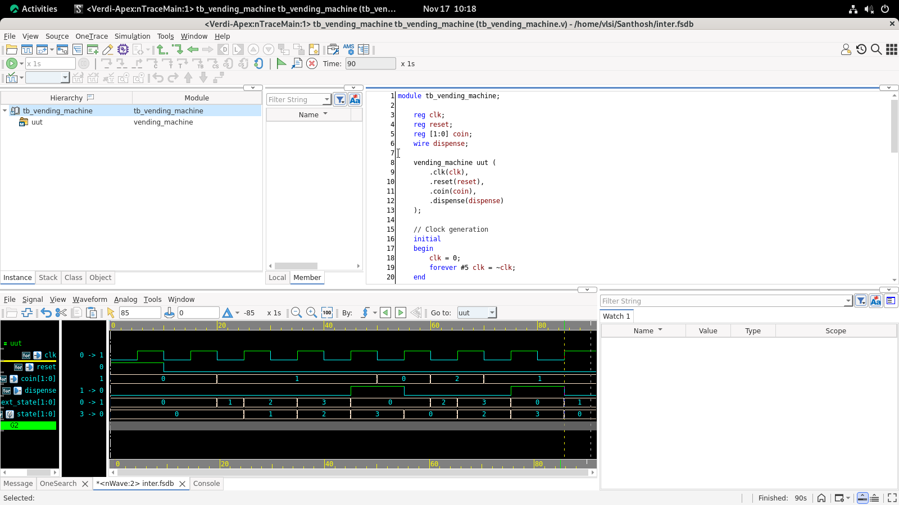

🔷 Vending Machine Controller | Moore FSM | Verilog HDL

📌 Project Overview

This project implements a Vending Machine Controller using a Moore Finite State Machine (FSM) in Verilog HDL.

The controller accepts ₹5 and ₹10 denominations and dispenses the product when the accumulated amount reaches or exceeds ₹15. The inserted amount is represented using FSM states, and the dispense output depends exclusively on the current state.

The project includes RTL design, testbench development, functional simulation using Synopsys VCS, and waveform analysis using Synopsys Verdi.

⚙️ Design Specifications
Parameter	Description
Design	Vending Machine Controller
FSM Model	Moore Machine
Number of States	4
Product Price	₹15
Accepted Denominations	₹5, ₹10
Coin Input	coin[1:0]
Output	dispense
Reset	Asynchronous
HDL	Verilog
Simulation	Synopsys VCS
Waveform Analysis	Synopsys Verdi
🔄 FSM State Transition

The vending machine uses four states to represent the accumulated amount.

Present State	Input ₹5	Input ₹10	dispense
S0	S5	S10	0
S5	S10	S15	0
S10	S15	S15	0
S15	S0	S0	1
State Description
S0 → No amount inserted (₹0).
S5 → ₹5 accumulated.
S10 → ₹10 accumulated.
S15 → Required amount of ₹15 reached or exceeded; product is dispensed.

After dispensing, the FSM automatically returns to the initial state S0 for the next transaction.

💰 Coin Encoding

The input coin[1:0] represents the inserted denomination.

Coin Input	Description
2'b00	No coin inserted
2'b01	₹5 inserted
2'b10	₹10 inserted

The input 2'b11 is unused in the current design.

🧠 Vending Machine Operation

The target product price is ₹15.

Since this is a Moore FSM, the output depends only on the present state.

text
dispense = f(current_state)

The output logic is:

text
S0  → dispense = 0
S5  → dispense = 0
S10 → dispense = 0
S15 → dispense = 1

Transaction Example — ₹5 + ₹10

FSM progression:

text
       ₹5              ₹10
S0 ─────────► S5 ─────────► S15
                              │
                              │ dispense = 1
                              ▼
                             S0

Transaction Example — ₹5 + ₹5 + ₹5
text
S0 ──₹5──► S5 ──₹5──► S10 ──₹5──► S15
                                      │
                                      │ dispense = 1
                                      ▼
                                     S0

When the accumulated amount reaches or exceeds ₹15, the controller enters state S15 and asserts dispense.

After one clock cycle in S15, the controller returns to S0.

No change-return mechanism is implemented in the current version.

🧩 FSM Architecture
text
                   Coin Input
                  (coin[1:0])
                       │
                       ▼
              ┌─────────────────┐
              │  Next-State     │
              │     Logic       │
              └────────┬────────┘
                       │
                       ▼
              ┌─────────────────┐
              │ State Register  │
              │   + Reset       │
              └────────┬────────┘
                       │
                 Current State
                       │
                       ▼
              ┌─────────────────┐
              │ Moore Output    │
              │     Logic       │
              └────────┬────────┘
                       │
                       ▼
                   dispense

🖼️ FSM State Diagram

<b>Figure 1: Moore FSM state transition diagram for the vending machine controller.</b>

🧪 Simulation and Verification
Tools Used
Verilog HDL — RTL Design
Synopsys VCS — Functional Simulation
Synopsys Verdi — Waveform Analysis
Compile
bash
vcs -full64 -kdb -debug_access+all \
vending_machine.v tb_vending_machine.v \
-o simv

Run Simulation
bash
./simv

Open Waveform
bash
verdi -dbdir simv.daidir &

The FSM states, coin inputs, clock, reset, and dispense output can be inspected in Synopsys Verdi to verify the controller's functionality.

📊 Simulation and Waveform
Synopsys VCS Simulation

<b>Figure 2: Functional simulation output captured using Synopsys VCS.</b>

Synopsys Verdi Waveform

<b>Figure 3: FSM waveform analysis using Synopsys Verdi.</b>

📈 Expected Output
Input Sequence

Transaction using three ₹5 coins:

text
Coin:       ₹5    ₹5    ₹5
State:      S0 →  S5 →  S10 → S15 → S0
dispense:    0     0      0     1     0

Transaction using ₹5 and ₹10:

text
Coin:       ₹5    ₹10
State:      S0 →  S5 →  S15 → S0
dispense:    0     0      1     0

The product is dispensed when the FSM reaches S15.

The dispense signal remains HIGH while the FSM occupies S15 and becomes LOW after the controller returns to S0.

This demonstrates successful Moore FSM-based vending machine control.

📁 Repository Structure
text
Vending-Machine-FSM/
│
├── vending_machine.v
├── tb_vending_machine.v
├── vending_machine_fsm.png
├── vending_machine_vcs.png
├── vending_machine_verdi.png
└── README.md

🎯 Learning Outcomes
Understanding Moore FSM architecture
Designing state transition logic in Verilog
Implementing sequential and combinational logic
Modeling a vending machine using FSM states
Understanding state encoding and output logic
Writing Verilog RTL and testbenches
Performing functional simulation using Synopsys VCS
Debugging RTL using Synopsys Verdi
Analyzing digital waveforms
Understanding practical RTL verification flow
🚀 Future Improvements
Support for additional coin denominations
Change-return mechanism
Multiple product selection
Product availability and stock monitoring
7-segment or LCD display for inserted amount
Moore and Mealy FSM comparison
SystemVerilog Assertions (SVA)
Functional and code coverage
RTL synthesis and PPA analysis
Static timing analysis
FPGA-based hardware implementation
RTL-to-GDSII implementation

<b>Designed and Simulated using Verilog HDL</b>
 
<i>Digital Design | Finite State Machines | RTL Verification</i>

